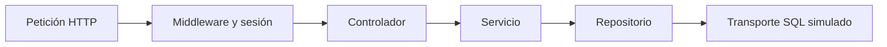

# Pruebas automáticas con Jest

## Ejecutar

Desde la raíz del repositorio, instalar las dependencias de cada aplicación:

```bash
npm --prefix server install
npm --prefix client install
```

No se necesita SQL Server, un archivo `.env`, ni iniciar la API para ejecutar la suite.
Se utiliza Node.js 24 y el código conserva sus módulos ESM (`import` y `export`).

| Comando desde la raíz | Qué ejecuta |
| --- | --- |
| `npm --prefix server test` | Todas las pruebas del servidor. |
| `npm --prefix server run test:unit` | Pruebas unitarias del servidor. |
| `npm --prefix server run test:integration` | Integración de la aplicación, con transporte SQL simulado. |
| `npm --prefix client test` | Las pruebas unitarias del cliente. |
| `npm --prefix server test -- planillas` | Solo los archivos de pruebas del módulo de planillas. |

También funciona `npm test` desde `server` o `client`; cada carpeta tiene su propia
instalación y configuración de Jest. No hay dependencias de pruebas en la raíz.
Si PowerShell bloquea `npm.ps1`, se puede usar `npm.cmd` en los mismos comandos.

## Organización

```text
server/jest.config.js          # Pruebas unitarias y de integración del servidor
client/jest.config.js          # Pruebas unitarias del cliente
server/test/
  asistencias/
  auth/
  bitacora/
  catalogos/                  # Rutas comunes de catálogos y permisos de acceso
  compartido/                # Controladores, servicios y transacciones de varios módulos
  deducciones/
  feriados/
  horasExtras/
  incapacidades/
  periodosPlanilla/
  planillas/
    conceptos.unit.test.js
    rutas.integration.test.js
  solicitudes/
  vacaciones/
  setup/                     # Entorno ficticio y bloqueo de conexiones reales
  support/                   # Ayudas para preparar datos de prueba
client/test/
  asistencias/
  solicitudes/
  setup/
```

Los archivos `*.unit.test.js` se ejecutan en los proyectos `servidor-unitarias` y
`cliente-unitarias`. Los archivos `*.integration.test.js` se ejecutan en
`servidor-integracion`. Las pruebas que abarcan varios módulos conservan su carpeta
compartida para evitar duplicarlas o atribuirlas a un módulo incorrecto.

## Qué tipo de pruebas tenemos

### Unitarias

Comprueban una unidad concreta con entradas controladas: una función de cálculo,
una validación, una comparación de bitácoras o un repositorio con su dependencia SQL
simulada. No necesitan HTTP ni una base de datos real.

Ejemplo: `server/test/planillas/conceptos.unit.test.js` comprueba que una jornada
completa diurna, mixta o nocturna conserve la equivalencia diaria; también verifica
feriados, extras, deducciones, redondeo y minutos en cero.

Los repositorios tienen pruebas unitarias de parámetros y resultados; estas pruebas
no ejecutan ni validan la sintaxis del SQL contra el motor.

### Integración de la aplicación

Comprueban la colaboración de componentes reales de la aplicación. Algunas llaman
un servicio que usa repositorios reales; otras levantan Express en un puerto local
temporal y envían peticiones HTTP con `fetch`.



Las suites de rutas cubren autenticación, catálogos, deducciones, incapacidades,
vacaciones y planillas. Los escenarios de asistencia y períodos también recorren
servicios y repositorios juntos.

Por ejemplo, el módulo de planillas comprueba:

- Acceso de cada rol y restricción por restaurante o colaborador.
- Cálculo de preplanilla con las fuentes de ingresos y deducciones.
- Registro de cabecera, detalles, conceptos y bitácoras en la misma transacción.
- Rechazo de pagos duplicados, anticipados o sin ingresos.
- Solicitud de rollback si falla la escritura de un concepto.

Las pruebas de deducciones incluyen creación por HTTP, código duplicado y fallo de
auditoría. En autenticación también se comprueba la cookie real de sesión del login.

Estas pruebas **ya existían en parte antes de la migración**: usar `node:test` no las
convertía automáticamente en unitarias. El tipo depende de los componentes que
participan y de qué dependencias se sustituyen, no del ejecutor elegido.

### Integración con SQL Server real: etapa pendiente

La suite automática actual sustituye el transporte SQL. Por eso un `commit` o
`rollback` observado demuestra que el servicio solicitó esa operación; no demuestra
que SQL Server haya confirmado o revertido registros realmente.

Para validar restricciones `CHECK`, claves foráneas, índices únicos, concurrencia,
bloqueos y persistencia, conviene una segunda suite contra una instancia y base
exclusivas para pruebas. Debe preparar sus propios datos, aplicar el esquema vigente,
comprobar el estado persistido y limpiar solo sus registros. No debe reutilizar la
base de desarrollo ni habilitarse por defecto con las credenciales del `.env`.

El primer flujo recomendado para esa etapa es registrar una planilla completa,
volver a consultarla, intentar un pago duplicado y provocar un fallo intermedio para
verificar que no quedan cabeceras o detalles parciales.

## Criterios de la migración

- Jest es el único ejecutor automático; no se conserva una capa que imite `node:test`.
- Se usan `test`, `test.each`, `expect`, `jest.spyOn`, relojes de Jest y hooks de Jest.
- Se conservan algunas aserciones de `node:assert/strict`, sobre todo para comprobar
  propiedades o identidad de excepciones con `assert.rejects`. Son compatibles con
  Jest y no ejecutan otro framework.
- Los mocks se restauran y el reloj vuelve a la hora real después de cada prueba.
- Las peticiones HTTP usan temporizadores reales; las pruebas de fechas sustituyen
  únicamente el reloj necesario para el escenario.
- No se carga `.env`. Un acceso a SQL sin simular falla antes de abrir una conexión.
- Se corrigieron referencias, firmas y datos simulados desactualizados detectados
  durante la ejecución inicial, conservando las comprobaciones de errores.
- No se modificó código de negocio para hacer pasar las pruebas.

Jest se instala como dependencia de desarrollo dentro de cliente y servidor.
Los comandos incluyen `--experimental-vm-modules`, necesario para ejecutar
el código ESM sin convertir la aplicación a CommonJS. La configuración sigue la
[documentación de ESM de Jest](https://jestjs.io/docs/ecmascript-modules).

## Prueba manual de interfaz

`client/test/asistencias/interfaz.html` y `interfaz.jsx` son una página de comprobación
de React que necesita un navegador. Se conserva en la carpeta de asistencias y se
abre con Vite en `/test/asistencias/interfaz.html`. Sus peticiones de negocio están
simuladas. No forma parte del total de pruebas de Jest y no se presenta como una
prueba automática de extremo a extremo.
